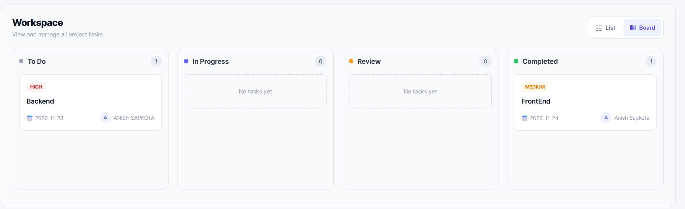

# Task Manager

A full-stack task and project management app with a Kanban board, team members and roles, comments, an activity feed and notifications. Built as a first full-stack project with Spring Boot, React and PostgreSQL, and run with Docker.



<!-- Add a screenshot of your Kanban board here:
 -->

## Features

- Register and log in with JWT authentication (passwords hashed with BCrypt)
- Create projects and tasks with status, priority and due date
- Kanban board with drag and drop, plus a list view
- Invite members to a project with roles (owner / member)
- Assign tasks to project members
- Comments on tasks
- Activity feed per project
- Notification bell for assignments and updates
- Access control: users only see projects they own or belong to

## Tech stack

| Layer | Technology |
| --- | --- |
| Backend | Java 21, Spring Boot 4, Spring Security, Spring Data JPA, Lombok |
| Database | PostgreSQL 16 |
| Frontend | React 18, Vite, axios, react-router-dom, @dnd-kit |
| Auth | JWT (jjwt) |
| DevOps | Docker, Docker Compose, nginx, GitHub Actions |
| Tests | JUnit 5, Mockito, MockMvc, Testcontainers |

## Project structure

```
task-manager/
├── backend/taskmanager/     Spring Boot app (model, repository, dto, service, controller, exception, security)
├── frontend/                React app (src/api, src/components, src/pages)
├── docker-compose.yaml
├── .env                     secrets (not committed)
└── .github/workflows/ci.yml
```

## Run with Docker

Requirements: Docker Desktop.

1. Create a `.env` file in the project root:

   ```env
   DB_PASSWORD=change-me
   JWT_SECRET=<a long base64 string>
   ```

2. Start everything:

   ```bash
   docker compose up --build
   ```

3. Open the app:
   - Frontend: check the `frontend` ports in `docker-compose.yaml` (for example http://localhost:3000)
   - Backend API: http://localhost:8080

Stop with `docker compose down`. Add `-v` to also delete the database data.

## Run locally for development

1. Start only the database:

   ```bash
   docker compose up -d db
   ```

   PostgreSQL is available on `localhost:5433` (database `taskmanager`).

2. Backend (in `backend/taskmanager`): run `TaskmanagerApplication` from your IDE or `mvn spring-boot:run`.

3. Frontend (in `frontend`):

   ```bash
   npm install
   npm run dev
   ```

## API overview

| Area | Endpoints |
| --- | --- |
| Auth | `POST /api/auth/register`, `POST /api/auth/login` |
| Projects | `GET/POST /api/projects`, `GET/PUT/DELETE /api/projects/{id}` |
| Tasks | `GET/POST /api/projects/{id}/tasks`, `PUT/DELETE /api/tasks/{id}`, `PATCH /api/tasks/{id}/status`, `PATCH /api/tasks/{id}/assignee` |
| Members | project member endpoints (add, list, remove) |
| Comments | comment endpoints per task |
| Activity | project activity feed |
| Notifications | list and mark as read |

All endpoints except `/api/auth/**` need the header `Authorization: Bearer <token>`.

## Tests

```bash
cd backend/taskmanager
mvn test
```

Unit tests use Mockito. Integration tests start a real PostgreSQL with Testcontainers, so Docker must be running. GitHub Actions runs the same tests on every push.

## Deployment checklist

| Item | What to do |
| --- | --- |
| Secrets | Use a long random `DB_PASSWORD` and `JWT_SECRET` in the server's `.env`. Never reuse local ones. |
| Database port | Remove the `ports: "5433:5432"` mapping from the `db` service. |
| CORS and API address | Set `CORS_ORIGINS` to your real site address and `VITE_API_URL` to your real API address, then rebuild the frontend. |
| HTTPS | Put a reverse proxy such as Caddy or nginx with a Let's Encrypt certificate in front. |
| Table changes | Switch `ddl-auto=update` to `validate` and manage the schema with Flyway migrations. |
| Backups | `docker exec taskmanager-db pg_dump -U postgres taskmanager > backup.sql` |

## What I learned

- Layered Spring Boot design (controller, service, repository, DTOs)
- Securing an API with Spring Security and JWT
- Connecting a React frontend to a REST API
- Running a multi-container app with Docker Compose
- Testing with Mockito and Testcontainers, and automating it with GitHub Actions

## Future ideas

- Flyway database migrations
- Task filters and search
- Due-date reminders by email
- Frontend tests
